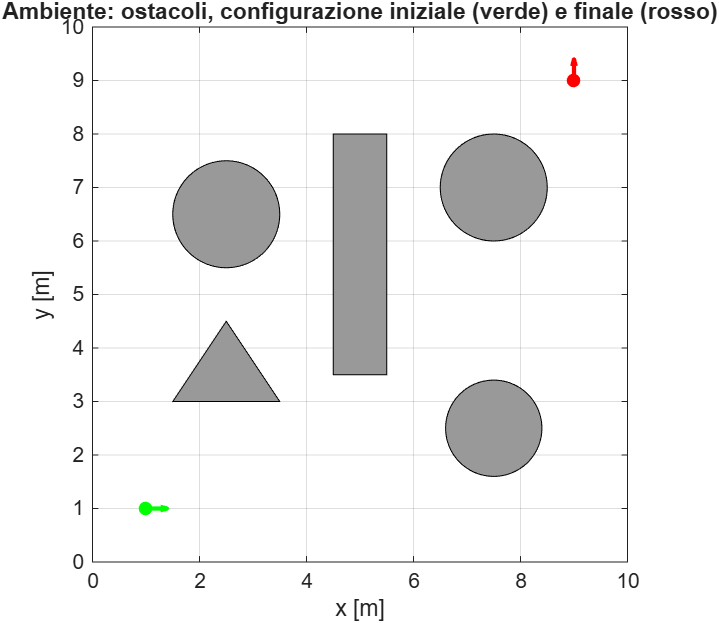
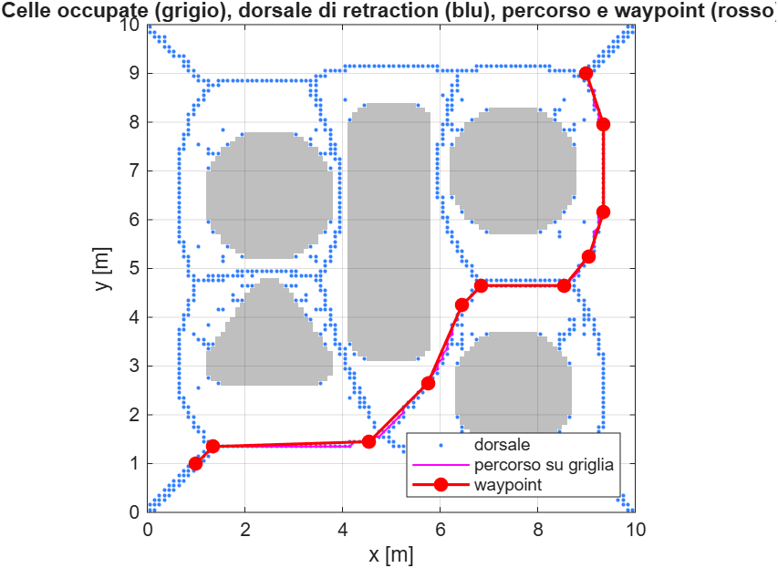
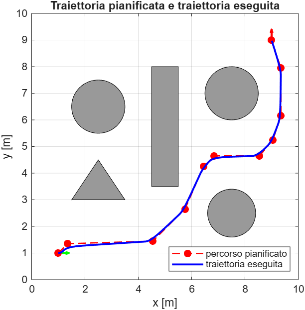
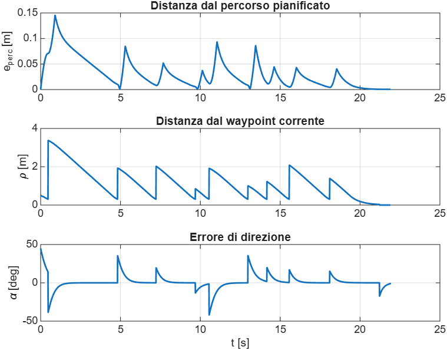
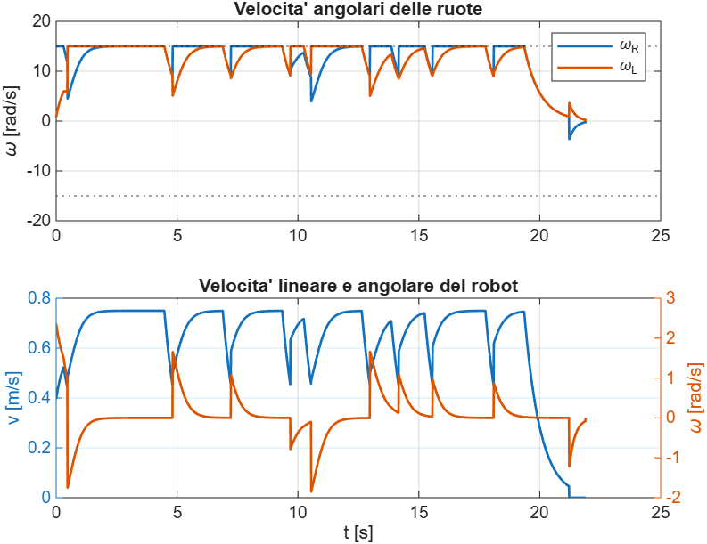
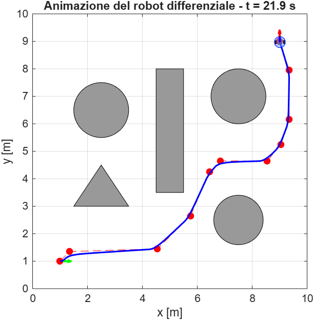

# Pianificazione e controllo di un robot mobile differenziale

Progetto MATLAB su un robot mobile differenziale che si muove nel piano XY tra ostacoli circolari e poligonali. Il percorso è pianificato con cell decomposition e retraction e poi seguito da un controllore cinematico in coordinate polari. Unità SI, angoli in radianti.

## Come eseguirlo

Si mettono tutti i file `.m` nella stessa cartella, la si imposta come cartella corrente e si lancia `main_mobile`. Lo script testa il modello, pianifica, simula, mostra grafici e animazione e salva tutto in `results/`. Da terminale: `matlab -batch "main_mobile"`. Non servono toolbox aggiuntivi. Per non generare la GIF basta mettere `salva_gif = false` all'inizio dello script.

## Modello

Lo stato è `q = [x y theta]'` e gli ingressi sono le velocità angolari delle ruote `wR` e `wL`. Con `r` raggio delle ruote e `d` interasse:

```
v = r/2 (wR + wL)        w = r/d (wR - wL)
xdot = v cos(theta)      ydot = v sin(theta)      thetadot = w
```

`vw_from_wheels` implementa la relazione diretta e `wheels_from_vw` quella inversa. Se una ruota supera la velocità massima, le due velocità vengono scalate dello stesso fattore, così la curvatura non cambia.

## File

| File | Contenuto |
|---|---|
| `main_mobile.m` | script principale |
| `build_environment.m` | ambiente 10 x 10 m, ostacoli, `q0` e `qf` |
| `dist_to_obstacles.m`, `point_segment_dist.m` | distanze dagli ostacoli |
| `plan_cell_retraction.m` | cell decomposition, grafo, retraction, Dijkstra |
| `simulate_diff_drive.m` | controllore, velocità delle ruote, integrazione RK4 |
| `wheels_from_vw.m`, `vw_from_wheels.m` | modello differenziale |
| `plot_environment.m`, `draw_robot.m`, `wrap_angle.m` | grafici e angoli |

## Pianificazione

1. L'ambiente è diviso in celle quadrate di lato 0.1 m. Gli ostacoli sono ingranditi del raggio del robot più un margine di sicurezza, così il robot si tratta come un punto. Una cella il cui centro cade nell'ostacolo ingrandito è occupata, le altre sono libere.
2. Le celle libere formano un grafo a 8 vicini, con peso uguale alla distanza tra i centri. Le diagonali tra due celle occupate sono vietate per evitare scorciatoie attraverso gli spigoli.
3. Per ogni cella libera si calcola la clearance, cioè la distanza dall'ostacolo più vicino o dal bordo. La retraction porta le celle sulla dorsale della mappa di clearance (i massimi locali), cioè i punti più lontani dagli ostacoli. Partenza e arrivo vengono portati sulla dorsale salendo lungo il gradiente della clearance.
4. Dijkstra cerca il percorso più breve sul grafo ridotto alla dorsale.
5. I waypoint si ottengono eliminando i punti allineati con Ramer-Douglas-Peucker, solo se il segmento che li sostituisce è libero da collisioni.

Se non esiste un percorso viene sollevato l'errore `plan_cell_retraction:NoPath`.

## Controllo

Per il waypoint corrente si calcolano `rho` (distanza) e `alpha` (errore di direzione):

```
v = k_rho * rho * cos(alpha)  (v = 0 se |alpha| > pi/2)
w = k_alpha * alpha
```

con `k_rho > 0` e `k_alpha > k_rho`. Il termine `cos(alpha)` evita che il robot avanzi quando è girato dalla parte sbagliata. Per i waypoint intermedi basta una tolleranza di 0.3 m, così il robot non rallenta a ogni punto. All'ultimo waypoint il robot ruota sul posto fino all'orientamento finale. Le velocità `(v, w)` sono convertite in `(wR, wL)` e si integra con Runge-Kutta del quarto ordine, passo 0.01 s.

Il modello del controllore coincide con quello simulato: niente slittamenti, rumore o dinamica dei motori.

## Verifiche

`main_mobile` si ferma con un messaggio se non sono vere queste condizioni: cinematica diretta e inversa coerenti (anche in rettilineo e in rotazione sul posto), partenza e arrivo fuori dagli ostacoli, percorso pianificato senza collisioni, posizione e orientamento finali entro tolleranza, traiettoria eseguita senza collisioni.

## Output

Ogni esecuzione scrive in `results/`:

| File | Contenuto |
|---|---|
| `ambiente.png` | ostacoli, configurazione iniziale (verde) e finale (rossa) |
| `pianificazione.png` | celle occupate, dorsale, percorso e waypoint |
| `traiettorie.png` | traiettoria pianificata ed eseguita |
| `errore_tracking.png` | distanza dal percorso, `rho` e `alpha` nel tempo |
| `velocita_ruote.png` | `wR`, `wL`, `v` e `w` nel tempo |
| `animazione_fine.png`, `animazione.gif` | ultimo fotogramma e animazione |
| `riepilogo.txt` | celle, lunghezza, tempi, errori, distanza minima |













## Risultati

Il codice è stato eseguito in MATLAB e tutti i controlli sono stati superati. Con `v = 0.40 m/s` e `w = -0.80 rad/s` il modello dà `wR = 5.600 rad/s` e `wL = 10.400 rad/s`.

La decomposizione produce 7127 celle libere e 2873 occupate, con 27090 archi nel grafo; la dorsale contiene 931 celle. Dijkstra trova un percorso di 11 waypoint lungo 14.04 m, contro 11.31 m in linea retta (rapporto 1.24, anche in `riepilogo.txt`): è più lungo perché passa sotto la parete e lontano dagli ostacoli. La distanza minima dagli ostacoli lungo il percorso pianificato è 0.570 m.

Il robot arriva alla configurazione finale in 21.90 s con errore di posizione 0.0298 m (tolleranza 0.03 m) e di orientamento 0.0190 rad (tolleranza 0.02 rad). L'errore di tracking, cioè la distanza dal percorso pianificato, è al massimo 0.146 m e in media 0.031 m; il massimo è nelle curve, dove il robot taglia i waypoint entro la tolleranza di 0.3 m. La traiettoria eseguita resta a 0.549 m dagli ostacoli, ben oltre il raggio del robot (0.20 m).

Le ruote saturano a 15 rad/s: la velocità lineare massima è 0.750 m/s e quella angolare massima 2.365 rad/s.

## Limiti

La retraction dà percorsi lontani dagli ostacoli ma non i più corti. La griglia limita i passaggi stretti: un corridoio più stretto del doppio dell'ingrandimento (0.7 m) risulta occupato, quindi il metodo è completo solo a meno della risoluzione scelta. Rispetto ai campi di potenziale non ci sono minimi locali, perché Dijkstra cerca in modo globale.
