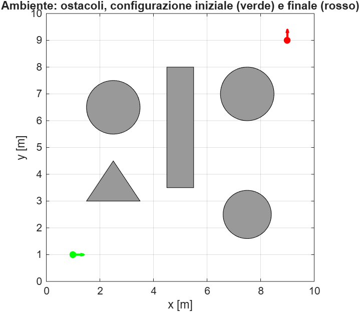
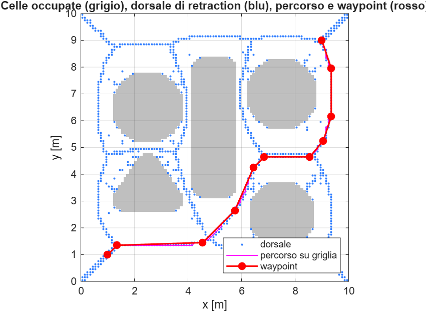
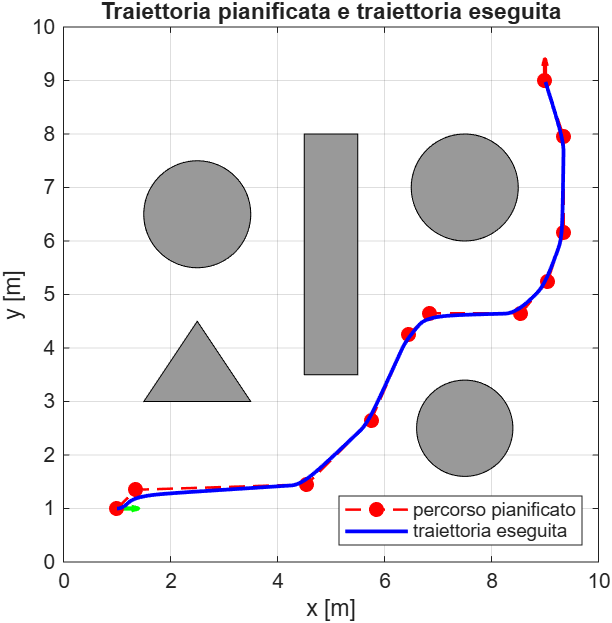
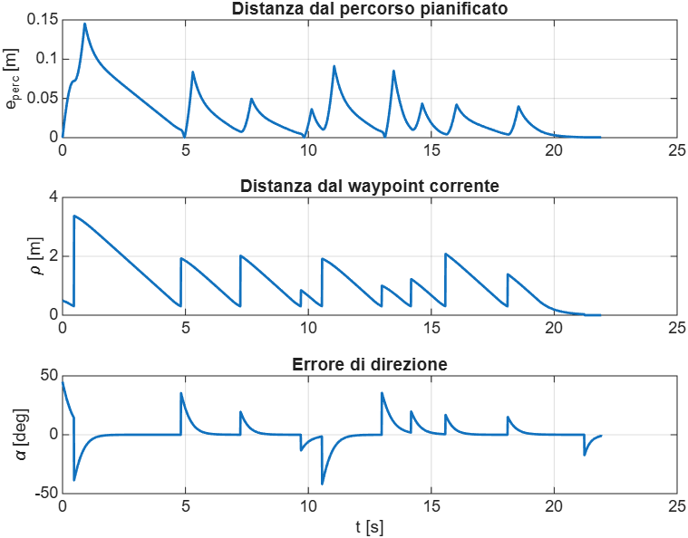
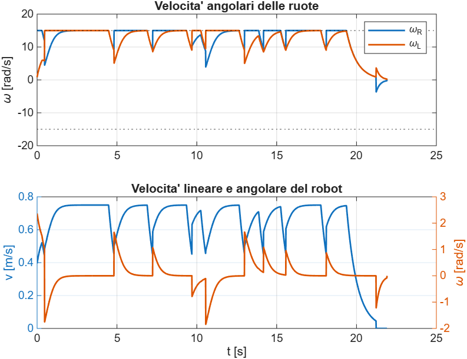
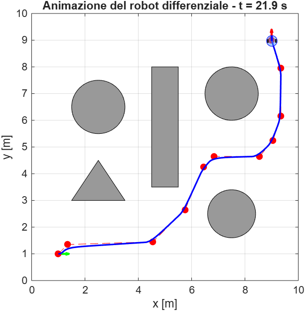

# **LM-32 - Robotica Intelligente**
# Progetto: Pianificazione e controllo di un robot mobile differenziale
### Infurna Giuseppe
### Matricola: 0322500071

Progetto MATLAB su un robot mobile differenziale con due ruote motrici indipendenti, che si muove nel piano $XY$ tra ostacoli circolari e poligonali. Il percorso è pianificato con cell decomposition e retraction e poi seguito da un controllore cinematico in coordinate polari. Unità SI, angoli in radianti.

## Come eseguirlo

Si mettono tutti i file `.m` nella stessa cartella, la si imposta come cartella corrente e si lancia `main_mobile`. Lo script testa il modello, pianifica, simula con Eulero esplicito, mostra grafici e animazione e salva tutto in `results/`. Il passo di integrazione è $\Delta t = 10^{-2}$ s. Non servono toolbox aggiuntivi. Per non generare la GIF basta mettere `salva_gif = false` all'inizio dello script.

Con `matlab -batch "main_mobile"` le figure si chiudono a fine esecuzione; per vederle usare l'interfaccia grafica o `matlab -r "main_mobile"`.

## Modello

Lo stato del robot è

$$
q = \begin{bmatrix} x & y & \theta \end{bmatrix}^T
$$

e gli ingressi sono le velocità angolari della ruota destra $\omega_R$ e sinistra $\omega_L$. Con $r$ raggio delle ruote e $d$ interasse, le relazioni cinematiche sono

$$
v = \frac{r}{2}\left(\omega_R + \omega_L\right), \qquad
\omega = \frac{r}{d}\left(\omega_R - \omega_L\right)
$$

e le equazioni di moto

$$
\dot x = v\cos\theta, \qquad \dot y = v\sin\theta, \qquad \dot\theta = \omega
$$

Lo script `vw_from_wheels` implementa la relazione diretta, `wheels_from_vw` quella inversa:

$$
\omega_R = \frac{v + \omega\,d/2}{r}, \qquad
\omega_L = \frac{v - \omega\,d/2}{r}
$$

Se una ruota supera la velocità massima $\omega_{\max}$, le due velocità vengono scalate dello stesso fattore, così la curvatura $\omega / v$ non cambia.

## Il codice

| File | Contenuto |
|---|---|
| `main_mobile.m` | script principale |
| `build_environment.m` | ambiente $10 \times 10$ m, ostacoli, $q_0$ e $q_f$ |
| `dist_to_obstacles.m`, `point_segment_dist.m` | distanze dagli ostacoli |
| `plan_cell_retraction.m` | cell decomposition, grafo, retraction, Dijkstra |
| `simulate_diff_drive.m` | controllore, velocità delle ruote, integrazione con Eulero esplicito |
| `wheels_from_vw.m`, `vw_from_wheels.m` | modello differenziale |
| `plot_environment.m`, `draw_robot.m`, `wrap_angle.m` | grafici e angoli |

## Pianificazione

1. L'ambiente è diviso in celle quadrate di lato $h = 0.1$ m. Gli ostacoli sono ingranditi del raggio del robot più un margine di sicurezza, così il robot si tratta come un punto. Una cella il cui centro cade nell'ostacolo ingrandito è occupata, le altre sono libere.
2. Le celle libere formano il grafo di adiacenza a 8 vicini, con peso uguale alla distanza tra i centri. Le diagonali tra due celle occupate sono vietate per evitare scorciatoie attraverso gli spigoli.
3. Per ogni cella libera si calcola la clearance, cioè la distanza dall'ostacolo più vicino o dal bordo. La retraction porta le celle sulla dorsale della mappa di clearance (i massimi locali), cioè i punti più lontani dagli ostacoli. Partenza e arrivo vengono portati sulla dorsale salendo lungo il gradiente della clearance.
4. Dijkstra cerca il percorso più breve sul grafo ridotto alla dorsale.
5. I waypoint $(x_i, y_i)$ si ottengono eliminando i punti allineati con Ramer-Douglas-Peucker, solo se il segmento che li sostituisce è libero da collisioni.

Se non esiste un percorso viene sollevato l'errore `plan_cell_retraction:NoPath`.

## Controllo

Per il waypoint corrente $(x_i, y_i)$ si calcolano la distanza $\rho$ e l'errore di direzione $\alpha$:

$$
\rho = \sqrt{(x_i - x)^2 + (y_i - y)^2}, \qquad
\alpha = \operatorname{atan2}(y_i - y,\; x_i - x) - \theta
$$

con $\alpha$ riportato in $(-\pi, \pi]$. Il controllore del materiale didattico è $v = k_\rho\,\rho$, $\omega = k_\alpha\,\alpha$; qui la velocità lineare è moltiplicata per $\cos\alpha$:

$$
v = \begin{cases} k_\rho\,\rho\cos\alpha & |\alpha| \le \pi/2 \\ 0 & |\alpha| > \pi/2 \end{cases}
\qquad
\omega = k_\alpha\,\alpha
$$

con $k_\rho > 0$ e $k_\alpha > k_\rho$. Il termine $\cos\alpha$ evita che il robot avanzi quando è girato dalla parte sbagliata. Per i waypoint intermedi basta una tolleranza di $0.3$ m, così il robot non rallenta a ogni punto. All'ultimo waypoint il robot ruota sul posto fino all'orientamento finale $\theta_f$, con $v = 0$ e $\alpha = \theta_f - \theta$.

Le velocità $(v, \omega)$ sono convertite in $(\omega_R, \omega_L)$ e il moto è integrato con Eulero esplicito, come nel materiale didattico:

$$
q_{k+1} = q_k + \Delta t\,\dot q_k, \qquad
\dot q_k = \begin{bmatrix} v_k\cos\theta_k \\ v_k\sin\theta_k \\ \omega_k \end{bmatrix}
$$

Il modello del controllore coincide con quello simulato: niente slittamenti, rumore o dinamica dei motori.

## Verifiche

Prima di simulare, `main_mobile` controlla con `assert` che:

- cinematica diretta e inversa siano coerenti, cioè che $(v, \omega) \to (\omega_R, \omega_L) \to (v, \omega)$ ridia i valori di partenza;
- in rettilineo ($\omega = 0$) sia $\omega_R = \omega_L$ e in rotazione sul posto ($v = 0$) sia $\omega_R = -\omega_L$;
- $q_0$ e $q_f$ siano fuori dagli ostacoli;
- il percorso pianificato sia senza collisioni.

Alla fine controlla anche che posizione e orientamento finali siano entro tolleranza e che la traiettoria eseguita non collida con gli ostacoli.

## Output

Ogni esecuzione scrive in `results/`:

| File | Contenuto |
|---|---|
| `ambiente.png` | ostacoli, configurazione iniziale $q_0$ (verde) e finale $q_f$ (rossa) |
| `pianificazione.png` | celle occupate, dorsale, percorso e waypoint |
| `traiettorie.png` | traiettoria pianificata ed eseguita |
| `errore_tracking.png` | distanza dal percorso, $\rho$ e $\alpha$ nel tempo |
| `velocita_ruote.png` | $\omega_R$, $\omega_L$, $v$ e $\omega$ nel tempo |
| `animazione_fine.png`, `animazione.gif` | ultimo fotogramma e animazione |
| `riepilogo.txt` | celle, lunghezza, tempi, errori, distanza minima |

## Risultati

Il codice è stato eseguito in MATLAB e tutti i controlli sono stati superati. Con $v = 0.40$ m/s e $\omega = -0.80$ rad/s il modello dà $\omega_R = 5.600$ rad/s e $\omega_L = 10.400$ rad/s.

La decomposizione produce 7127 celle libere e 2873 occupate, con 27090 archi nel grafo; la dorsale contiene 931 celle. Dijkstra trova un percorso di 11 waypoint lungo $14.04$ m, contro $11.31$ m in linea retta (rapporto $1.24$): è più lungo perché passa sotto la parete e lontano dagli ostacoli. La distanza minima dagli ostacoli lungo il percorso pianificato è $0.570$ m.

Il robot arriva alla configurazione finale in $21.90$ s con errore di posizione $0.0298$ m (tolleranza $0.03$ m) e di orientamento $0.0190$ rad (tolleranza $0.02$ rad). L'errore di tracking, cioè la distanza dal percorso pianificato, è al massimo $0.146$ m e in media $0.031$ m; il massimo è nelle curve, dove il robot taglia i waypoint entro la tolleranza di $0.3$ m. La traiettoria eseguita resta a $0.549$ m dagli ostacoli, ben oltre il raggio del robot ($0.20$ m).

Le ruote saturano a $\omega_{\max} = 15$ rad/s: la velocità lineare massima è $v_{\max} = r\,\omega_{\max} = 0.750$ m/s e quella angolare massima $|\omega| = 2.365$ rad/s.

### Figure

Ambiente con ostacoli, configurazione iniziale (verde) e finale (rossa).

Celle occupate (grigio), dorsale della retraction (blu), percorso sulla griglia e waypoint (rosso).

Traiettoria pianificata e traiettoria eseguita.

Distanza dal percorso pianificato, $\rho$ e $\alpha$ nel tempo.

Velocità delle ruote $\omega_R$, $\omega_L$ e velocità del robot $v$, $\omega$.

Ultimo fotogramma dell'animazione.

## Limiti

La retraction dà percorsi lontani dagli ostacoli ma non i più corti. La griglia limita i passaggi stretti: un corridoio più stretto del doppio dell'ingrandimento ($2 \cdot 0.35 = 0.7$ m) risulta occupato, quindi il metodo è completo solo a meno della risoluzione scelta. Rispetto ai campi di potenziale non ci sono minimi locali, perché Dijkstra cerca in modo globale.
